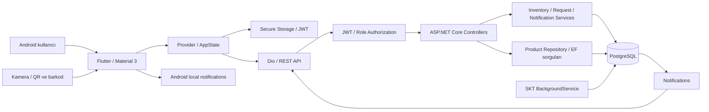
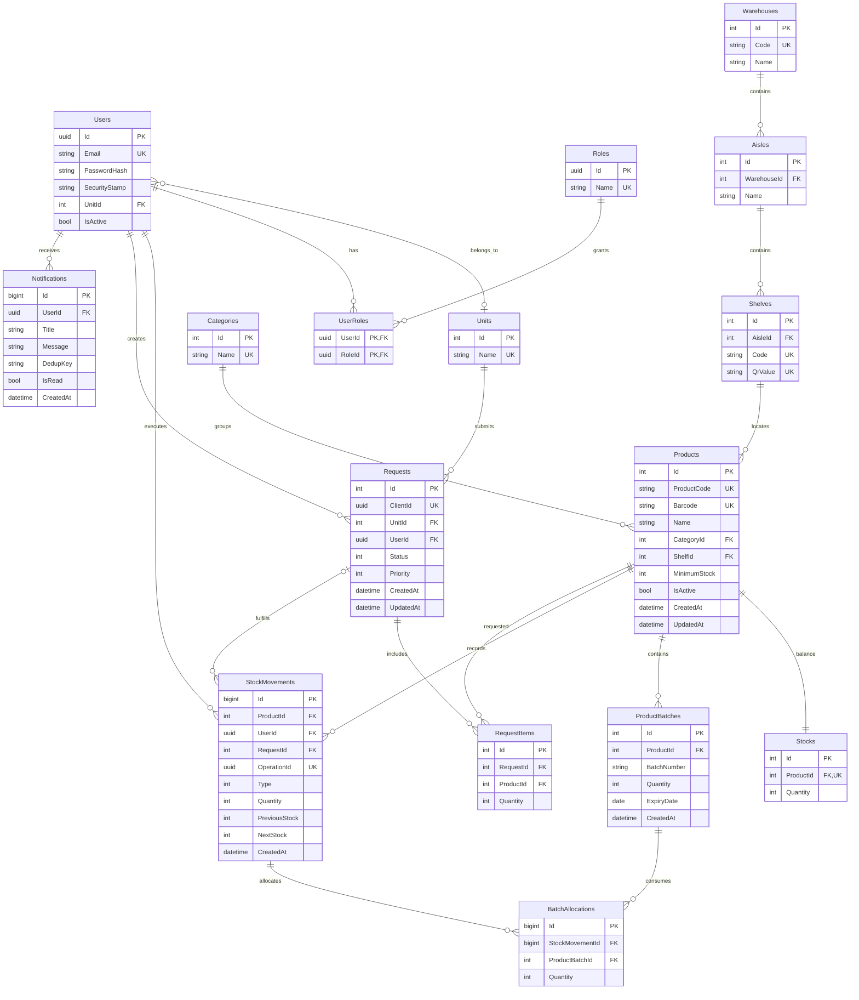
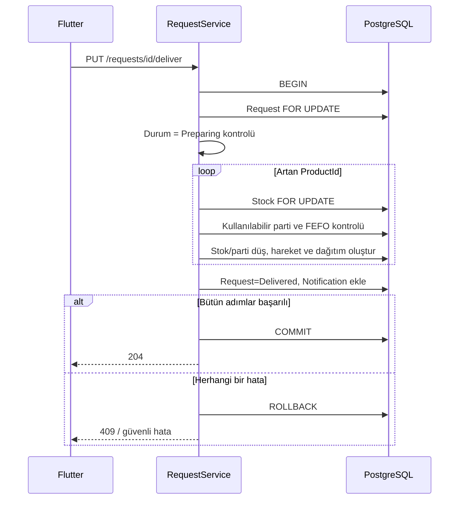

# Mimari

## Veri modeli

Identity'nin claim, login ve token tabloları da EF Identity altyapısı tarafından oluşturulur. Kullanıcı başına API üzerinden tek operasyonel rol atanır. Bir ürün bir stok satırına ve bir raf konumuna sahiptir. Bu karar ekranları ve stok/parti invariantlarını sade tutar; aynı ürünün aynı anda farklı raflarda tutulması ayrı StockLocations/transfer modeli gerektirir.

## Teslim işlemi

Read Committed + açık satır kilitleri kullanılır. Teslim edilen veya iptal edilen talep tekrar değişmez. Stok hareketi `NextStock = PreviousStock + Quantity` ve negatif olmama CHECK kısıtlarıyla doğrulanır. Her giriş ve çıkışın parti dağıtımı kaydedilir. SKU/barkod/QR/istek kimlikleri benzersiz indekslerle korunur.
